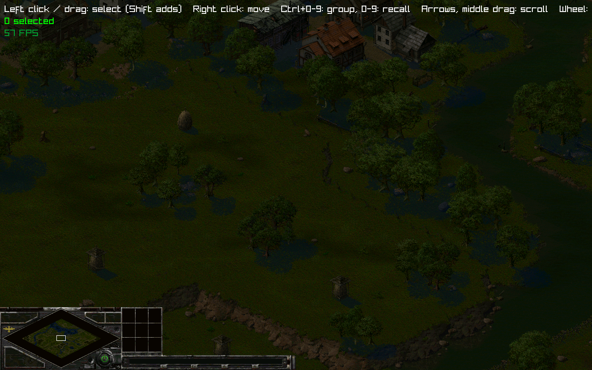

# OpenStrike

Open-source reimplementation of the Sudden Strike engine (Fireglow / CDV, 2000), in the spirit of OpenRA and OpenTTD:
a modern engine running natively on macOS, Linux and Windows, which reads the data of an original copy of the game.

OpenStrike ships no game data. You need your own copy of *Sudden Strike Gold* (Steam/GOG).

## Status

Early engine: a map is drawn in the game's isometric view with its ground, roads, rails, trees, fences and
buildings, bridges and piers; a platoon of six tanks can be selected and sent around water and buildings,
moving and finding their way with the original game's rules and path finder.
File formats are being reverse engineered; see `docs/formats.md`, `docs/movement.md` and the address index `docs/original-code.md`.

## Screenshot



## Architecture

Functional core, imperative shell:

- `crates/formats` (`openstrike-formats`): pure decoders, bytes in, plain data out (archives, palettes, sprites, maps, ground).
- `crates/sim` (`openstrike-sim`): the deterministic simulation, `step(&World, &Rules, &[Command]) -> World` at the
  game's 25 ticks per second, reproducing the original movement code (`docs/movement.md`), so that replays and
  lockstep multiplayer stay possible. Integer arithmetic, except where the original itself uses floating point.
- `crates/client` (`openstrike`): the raylib shell. It reads devices into commands, calls `step`, and draws the world.
  No game logic lives here.

Tests sit next to each crate in `tests/` and only use the public API.

## Running

Put your copy of the game in `data/SuddenStrikeGold/` (ignored by git), then:

```sh
cargo run --release -p openstrike                      # default map
cargo run --release -p openstrike -- path/to/map.ssm --climate winter
cargo test --workspace --release                        # data tests are skipped without the game
```

Controls: left click or drag to select (Shift adds), right click to move, arrows / WASD or middle drag to scroll,
wheel to zoom, B to show blocked cell quarters.
Debug options: `--look-at x,y`, `--zoom z`, `--show-blocked`, `--screenshot file.png`.

## Layout

- `crates/` the engine
- `docs/` technical notes (file formats, game logic)
- `tools/` Python analysis and extraction scripts

## License

OpenStrike is free software, released under the GNU General Public License version 3 or later (see `LICENSE`).
It contains no data from the original game, which remains the property of its rights holders.
